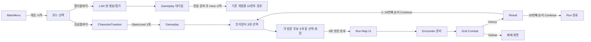

# ProjectA 구현 구조와 설정

기준일: 2026-11-10. 현재 모듈 책임·실행 절차·콘텐츠 설정만 적는다. 작업 경위와 검증 기록은 커밋 본문으로 조회한다.

| 영역 | 기준 문서 |
|---|---|
| 게임 규칙 요약 | [GAME_STATUS](GAME_STATUS.md) |
| 남은 작업·제안 | [TODO](TODO.md) · [ITEM_DESIGN](ITEM_DESIGN.md) |
| Snapshot·Co-op·저장/재개·온라인 계약 | [MULTIPLAYER](MULTIPLAYER.md) |
| UI 구조 | [UI_README](UI_README.md) |
| 에셋 도구 명령 | [Scripts README](../Source/ProjectAEditor/Scripts/README.md) |

- 전투는 [GAME_STATUS 6절](GAME_STATUS.md#6-라운드-전투)의 행동 계획·시간차 실행이다. 순차 턴·AI 연속 행동·End Turn은 제거했고 이전 Blueprint 참조용 클래스·프로퍼티만 남긴다.
- 저장된 준비 완료 경계에서만 복구한다. 진행 중 시전·투사체의 임의 시점 복원은 없고 이전 순차 Combat 저장은 거절한다.
- 수치는 진행용 시험값이다. 온라인 미구현 범위는 [멀티플레이 계약](MULTIPLAYER.md#9-steamplayfab와-남은-서비스-정책)을 따른다.

## 1 기본 실행 흐름

환경: UE 5.8 `ProjectA.uproject`, 타깃은 `BuildSettingsVersion.V7`·`EngineIncludeOrderVersion.Unreal5_8`.

1. 시작 맵 `/Game/User_JeHoon/LEVEL/Core/MainMenu`.
2. 게임 시작 → 싱글플레이 → CharacterCreation에서 1~4명 생성, 직접 조작할 1명 선택. 멀티플레이는 같은 PC·LAN 개발용 방으로 연결한다.
3. Start Game → `/Game/User_JeHoon/LEVEL/Core/Gameplay` → 인카운터 3회 선택 → Run Map의 Combat 노드.
4. 전투: 대상(또는 타일) 클릭 → 장착 스킬 버튼 → 준비 완료. 이동은 이동 예약 → 아군 빈칸 클릭(SAP 1). 나머지 동료는 서버 AI가 계획한다.
5. 전원 준비 후 SAP 이동 → AP 행동 순으로 해결하고 잔여 투사체까지 정리되면 다음 라운드로 간다. 해결 중 입력은 받지 않는다.
6. 새 싱글 Run은 PvE와 로컬 Snapshot을 번갈아 20전투, 전투마다 인카운터 3회로 총 80단계다. 규칙은 [5-1절](#5-1-목표-run과-회복-시험-데이터).
7. 패배(양 팀 전멸 포함)는 Defeat 화면 후 Run 종료이며 보상이 없다.



- Gameplay는 단일 레벨이다. 새 싱글은 `TargetCombat_01`~`TargetCombat_20`을 쓴다.
- 기존 `Combat_01`~`Combat_02/10` 저장, 개발 협동, `-ProjectAPrototypeRun`은 10전투 경로를 유지한다.
- Run Map은 완료 수/전체 노드 수를 표시하고 `NodeList`를 최대 높이 300 스크롤로 감싼다. WorldMap 탐험과 전투별 맵 전환은 없다.
- MainMenu 백과사전은 Run 생성 없이 현재 카탈로그·규칙을 읽으며 기존 저장의 고정 수치를 바꾸지 않는다.
- C++·리플렉션 변경 후에는 UE를 재시작한다.

### 1-1 로딩 화면 플러그인

- `Plugins/AsyncLoadingScreen`: MIT 공개 소스 1.7.0, UE 5.8용 [커밋 77f3cdcf](https://github.com/truong-bui/AsyncLoadingScreen/tree/77f3cdcfc32afa2422d1208e04b61df3bd9a52dc). 기능은 변경하지 않았고 데모 Content는 제외했다. `LICENSE`는 NonUFS 런타임 의존성으로 등록한다.
- `PreLoadingScreen` 단계에서 MoviePlayer를 처리한다. 전용 서버에서 제외하며 GameInstance·OpenLevel 후킹은 없다.
- 설정: `DefaultGame.ini`의 `/Script/AsyncLoadingScreen.LoadingScreenSettings`. 맵 로드가 끝나면 자동 종료하고 최소 표시 시간·수동 종료·키 입력은 쓰지 않는다.
- 배경은 `/Game/DemonicUI/Backgrounds/Background.Background`를 직접 참조한다. `UProjectAAssetManager::ModifyCook`이 지정한 배경 패키지만 쿠킹에 추가한다.
- 같은 Gameplay 월드의 PvE 준비는 MoviePlayer 대신 미로 이동과 native 회전 표시를 쓴다.

### 1-2 언어 리소스와 배포

- 기본 문화 `ko`. `GameUserSettings.ini`의 `Internationalization.Language`가 우선한다.
- PIE는 `UProjectALanguageSubsystem`이 게임 텍스트만 미리보기한다(다중 PIE 창은 언어 공유).
- 번역 원본 `Config/Localization/*.json`, 엔진 리소스 `Content/User_JeHoon/Localization/Game`의 `Game.locmeta`·`ko/en/Game.locres`. `ProjectA.Build.cs`가 UFS 의존성으로 포함한다.
- 패키징은 ICU `All` 프리셋과 `ko/en` 문화만 지정한다.
- 작성·검사: `python Source/ProjectAEditor/Scripts/BuildLocalization.py` (`--check`). 현재는 [현지화 보류](../AGENTS.md#현지화-보류) 상태다. [표시 계약](UI_README.md#15-언어와-번역-리소스)

## 2 모듈과 책임

런타임은 `Source/ProjectA`, 에셋 도구·에디터 테스트는 `Source/ProjectAEditor`다. 런타임에 Editor 의존성을 넣지 않는다.

| 구성 | 책임 |
|---|---|
| `URunStateSubsystem` | GameInstance 수명. Run·소유권·관리 lease, 저장 성공 후 상태 반영. `RunProgressRules`·`RunSaveFormat` 사용 |
| `AGameplayGameModeBase` | 서버의 Arena·EncounterManager·CombatManager 준비와 참가자 배정. 종료 시 lease 해제 |
| `AGameplayGameState` | 단계·파티·노드·결과를 읽기 전용 뷰로 복제 |
| `AGameplayPlayerController` | 로컬 Root UI, 전투 RPC, Host의 노드 선택·Continue 요청 |
| `UGameplayRootWidget` | CommonUI Run/Combat/Modal 스택, 저장 실패·재시도 안내 |
| `URunMapWidget` | 노드·진행 표시와 선택 요청. 직접 Spawn하지 않음 |
| `URunEncounterWidget` | 후보 3개 선택, 상품 진열·리롤·구매, 회복·소모품·부활 서비스 |
| `AEncounterManager` | Encounter 준비·스폰·전투 연결·종료 HP/재고 추출·Run 전이 |
| `ACombatArena` | Grid·슬롯 좌표·카메라·타일 활성화 |
| `ACombatManager` / `ACombatRoundCoordinator` | 라운드 계획·시간표·실행·잔여 공격 정리·결과 확정 |
| `UCombatActionAuthority` | Run 식별·소유권·연결·lease·Human/AI 검증 |
| `AUnitBase` / GAS / Grid | 서버 HP/AP·사망·위치/복귀 칸·복제 표현 |
| `CombatAIPlanning` | 장착 순서·태그 조건으로 일반 스킬 선택, `Skill.AI.Fallback`은 대체 행동 |
| `ACombatRoundPlayerController` / `UCombatRoundPlanningWidget` | 계획·준비 RPC와 CommonUI 계획 화면 |
| `UEncounterResultWidget` | PvE 아이템 3택1·공통 골드, Snapshot 무보상 결과, 패배 안내 |

- Run/Party/Encounter/Command는 직렬화 가능한 값 데이터가 기준이다.
- `UTurnManager`·`UCombatHUDWidget`·이전 AI 컴포넌트는 참조 호환용 외형만 남긴다.

## 3 파티와 전투 규약

- 새 일반 Target Run은 `WeaponSkillAcquisitionVersion=1`이다. 스킬상점이 없고 비무장 기본 공격과 장착 무기 스킬을 쓴다.
- 버전 0(무기 스킬 도입 전 Run, prototype, 개발 협동)은 기존 스킬상점·습득 경로를 유지한다.
- 등급·확률은 [GAME_STATUS 3-1](GAME_STATUS.md#3-1-등급과-확률)을 따른다.

### 3-1 시작 장비와 장착

**장착 구조**

- `UProfessionBase.StartingEquipment`가 직업별 시작 원본과 슬롯을 정의한다. 새 Run에서 `Items`에 지급하고 `FRunEquipmentState`(슬롯·아이템 인덱스·Revision)로 장착한다.
- `Items`는 추가 전용 배열이며 같은 에셋도 사본마다 구분한다. 원본이 없으면 지급을 생략하고 슬롯을 비운다.
- `URunEquipmentCatalog`: `GameplayTagQuery`·허용/점유 슬롯·소켓/상대 변환의 native CDO 데이터. 에셋별 프로필이 태그 프로필보다 우선하며 이름·직업으로 판정하지 않는다.
- `RunEquipmentRules`가 중복 점유·사본·호환 교체를 검증한다. 양손검·시작 스태프는 두 손을 점유한다.
- 슬롯 태그 7개: `Equipment.Slot.Weapon.MainHand/OffHand`·`Head`·`Hands`·`Feet`·`Body`·`Accessory`.
- 착용 프로필 `BodyArmor`·`HandArmor`(`Bracers` 포함)·`Accessory`(`Cloak`)는 `bFollowBodyPose`로 몸체에 `SetLeaderPoseComponent`를 건다. 스켈레탈 메시만 허용하고 충돌·내비게이션에 관여하지 않는다. 카탈로그는 [ARMOR_ASSETS.csv](../DataCatalogs/ARMOR_ASSETS.csv)(`RunArmorCatalog`)이며 디버그 전투에만 합친다.
- `ChangeEquipment`: 상점 단계·신뢰 소유자·생존 Human·인덱스·Revision을 검증하고 저장 후보를 원자 반영한다. 실패하면 상태를 유지한다.
- `CharacterEquipmentComponent`가 소켓에 원본 메시를 붙인다. 손잡이 위치는 프로필의 `Attachments.RelativeTransform`으로 조정한다.
- 이전 저장의 누락된 장비 상태는 과거 외형을 유지하고 첫 명시 장착부터 새 상태를 쓴다. 미지원 240개는 판매 목록에서만 제외했고 원본·기존 보유 사본은 유지한다.

**무기 스킬 부여**

- `RunWeaponSkillRulesDataAsset`: 62후보, 무기 종류 Query, 등급 Query. 탄약·기타는 스킬 없이 등급만 받는다.
- `ItemQueryOverrides`의 첫 일치 규칙으로 `Skill.Effect.Shield` 7종을 `Item.Weapon.Shield`에만 연결한다. 치유 6종은 마법 무기에 둔다.
- 장비 등급 `Item.Rarity.*`와 스킬 등급 `Selection.WeaponSkill.Rarity.*`는 별도다. 적격 스킬이 있는 등급을 먼저 뽑고 등급 안에서 `BaseWeight`로 추첨한다. 후보가 없으면 임의 스킬로 채우지 않는다.
- `RunSkillBalance::Load`: [SKILL_BALANCE.csv](../DataCatalogs/SKILL_BALANCE.csv) 62행·11열, [SKILL_RARITY_PROBABILITIES.csv](../DataCatalogs/SKILL_RARITY_PROBABILITIES.csv) 25행·6열. `SchemaVersion=1`·`BalanceVersion=1`로 저장한다. ID·경로·태그·행 중복·장비별 합계 100을 검사하고 오류면 생성에 실패한다. 버전 0은 원본 수치를 쓴다.
- `FRunItemDefinition`: `CatalogRarityTag`, GUID `ItemInstanceId`, `GenerationVersion`, `RarityTag`, `GrantedSkills`, `SkillBalanceVersion/GrantedSkillBalances`, `WeaponDamage`(누락 시 10).
- 사본 생성 결과와 당시 `WeaponSkillRules`를 Run에 저장한다. 구매는 같은 사본을 인계하고 재장착·Continue로 재추첨하지 않는다. 동일 Skill ID는 한 번만 추가한다.
- `RunWeaponSkillRules::ResolveSkill`은 원본 실행 정의에 저장된 위력·AP/SAP·선딜만 적용한다. 양 팀의 같은 SkillId는 같은 수치다. 기본 공격·몬스터·소모품은 조정하지 않는다.
- `UEquipmentCombatRules.BasicWeaponAttacks`: 기본 타격은 장착 공격 무기의 평균 피해를 쓰고 방패를 제외한다.
- `UEquipmentCombatRules.IntrinsicSkills`: 아이템 태그 Query로 단검에 `Skills/Weapons/DA_DoubleStrike`를 부여한다. 각 슬롯의 `RequiredEquipment`를 모두 만족해야 실행한다. `MeleeStrikes`의 왼손·오른손 타격은 0.184초·0.584초, 몽타주는 2.1초를 1.25배속(1.68초)으로 재생하며 비용은 한 번만 차감한다. `ConditionalSkillVersion=0/1` 저장은 다음 명시 장비 변경에서 버전 2로 갱신한다.
- 프로젝트 전용 DA: `Skills/Weapons/DA_MeleeAttack`·`DA_CrossbowAttack`·`DA_DoubleStrike`·`DA_ShieldCharge`, `Weapons/DA_WeaponSkillRules`. 작성 도구는 `CreateWeaponSkills.py`·`CreateDoubleStrike.py`다.
- Snapshot 상대의 새 무기 스킬 등록·사본 공개는 후속 작업이며 새 Target Run은 고정 Snapshot 상대를 유지한다.

### 3-2 상점 인카운터

**판매** (`FRunItemSaleCommand`, `RunItemSaleRules`)

- 서버가 연결 소유자·생존 Human·상점 태그·현재 방문·미장착 사본·골드 한도를 검사한다.
- 가격은 저장된 `Item.Price`의 절반 내림, 최소 1G. 기본·등급·태그 상점에서만 허용한다. 서비스·소모품·구형 스킬상점·장착품·0 이하 가격은 거절하고 되사기는 없다.
- 판매하면 아이템 제거, 뒤쪽 슬롯 인덱스 보정, 장비·상점 Revision 증가, `bItemSold` 기록을 한 저장 후보로 처리한다.
- 클라이언트는 요청 GUID와 두 Revision 도착을 기다리며 구매·판매·장비 변경을 동시에 제출하지 않는다.

**스킬·소모품 제한**

- 스킬 소지·장착은 단일 목록이며 개수 상한이 없다. `UnitDataRules::IsValidSkillCount`의 최소 필요 수와 ID·중복·태그 검증은 유지한다.
- 소모품 종류 상한은 `RunRecoveryRules::MaximumStackTypes=5`, 상점 진열은 최대 5개다.

**전투 승리 보상**

- 버전 1 Target Run은 PvE 승리마다 `FRunGoldRewardState` 스키마 2에 노드·아이템 3후보·공통 골드·캐릭터별 수령 기록을 저장한다.
- 공통 골드는 해당 `Group.GoldChoices`의 최솟값~최댓값 정수 추첨(양 끝 포함)이며 선택과 무관하다.
- 아이템은 저장된 `FRunItemShopState.Catalog/RarityProbabilities`와 공통 추첨 경로를 쓰고 직전 상점의 `ActiveItemQuery`는 적용하지 않는다. 중복 없는 3개를 제시하고 선택한 사본은 가방에 넣는다(자동 장착 없음).
- 서버가 소유자·Human·노드·인덱스·미수령·잔액을 검증하고 아이템·골드·수령을 한 저장 후보로 확정한다. 저장 실패 시 캐시된 후보를 유지한다.
- 사망한 직접 조작 캐릭터도 수령하고 AI는 제외한다. 대상 인간이 모두 선택해야 Continue한다. Snapshot·패배에는 보상이 없다.
- 스키마 0/1의 저장된 보상은 그대로 복원한다. 버전 0 Target은 묶음별 골드 3택1, prototype·개발 협동은 `GoldRewardMin/GoldRewardMax`(5/15) 골드 3후보와 Host Continue를 유지한다.

**방문 흐름**

- 새 목표 Run은 전투 전마다 `EncounterChoice`에서 후보 하나를 골라 `Shop`으로 방문한다. 나가기 두 번은 다음 선택, 세 번째는 `Map`으로 간다.
- `FRunEncounterProgress.AfterCompletedNodeCount`에 방문 직전의 완료 전투 수를 저장한다. 목표 schema 2는 `VisitIndex`와 완료 선택 수도 검증한다.
- 전이는 저장 후보에서 계산하고 저장 성공 후 반영한다. 실패하면 상태를 유지하고 같은 버튼으로 재시도한다.
- 통합 Gameplay에서는 방문에 맞는 NPC 공간으로 로컬 카메라를 옮긴다. [공간과 연출](#4-13-통합-gameplay와-npc-상점)

**새 일반 Run의 인카운터 풀** ([ENCOUNTER_POOL.csv](../DataCatalogs/ENCOUNTER_POOL.csv), 15열·28행)

- 열: `인카운터 ID,게임 내 이름,상점 종류,속성,분류 태그,판매 대상,활성 여부,그룹 태그,그룹 가중치,변형 가중치,상품 필수 태그,상품 제외 태그,진열 정책,구현 상태,확인 사항`.
- 활성 13개(기본 1·등급별 4·태그별 5·서비스 3), 비활성 보존 15개. 필수 태그는 모두 일치, 제외 태그는 하나라도 일치하면 제외한다. 진열 정책은 `기본5`·`최대5`.
- Run 생성 때 활성 후보·가중치·Query·진열 정책과 `FRunTargetState.EncounterSelectionVersion=1`·`EncounterSeed`를 고정한다.
- 그룹 → 변형 순으로 추첨해 중복 없는 3개를 제시한다. 선택한 ID와 고갈된 그룹은 제외하고 재정규화한다. 저장된 시드로 같은 제시를 재현하며 Continue 중 CSV를 다시 읽지 않는다.
- `FRunItemShopState.SelectionVersion=1`의 `ActiveEncounterId/ActiveItemQuery/ActiveStockPolicyVersion`에 방문한 상점을 저장한다.
- 선택 가능한 상점에 적격 상품이 0개이면 Run 설정에서 거절한다. [분류와 가중치](GAME_STATUS.md#4-상점과-인카운터)

**아이템 카탈로그** ([WEAPON_ASSETS.csv](../DataCatalogs/WEAPON_ASSETS.csv), 50행)

- 8열: `무기 종류,위치,에셋 이름,가격(G),게임 내 이름,등급,분류 근거,무기 피해량`. 가격은 모두 1G, 피해량은 공격 무기·방패 10, 화살통 0.
- `RunItemShopCatalog::Load`는 모든 행의 `URunEquipmentCatalog::ResolveProfile` 성공을 요구한다. 잘못된 입력은 카탈로그 전체를 거절하고 기존 출력을 보존한다.
- 가격은 `1~2,147,483,647` 정수만 허용한다(앞뒤 공백·선행 `+`·선행 0 허용). `등급`은 5개 색 이름과 일치, `분류 근거`는 빈 값·제어 문자·256자 초과를 거절한다.
- 표시명은 식별자가 아니다. 경로 기반 ID와 GameplayTag 분류를 쓴다. 이전 4·5·6·7열 CSV의 해석은 유지한다.

**등급 확률** ([ITEM_RARITY_PROBABILITIES.csv](../DataCatalogs/ITEM_RARITY_PROBABILITIES.csv))

- `ConfigureTargetRun`이 `FRunItemShopState.RarityProbabilities`에 확률 스키마 1을 저장한다(`RarityTag`, `ProbabilityBasisPoints` 0~10000, 합 10000).
- 진열·리롤·보상마다 등급을 먼저 뽑고 등급 안에서 에셋을 균등 추첨한다. 같은 진열에서 에셋 중복 금지, 등급 반복 허용. 빈 등급·0%는 제외해 재정규화한다.
- 기본상점은 적격 에셋이 5개 미만이면 실패한다. 전문 상점은 Query 안의 적격 수와 5 중 작은 수를 진열하고, 후보가 없으면 빈 진열·퇴장을 허용하며 유료 리롤을 막는다.
- 스키마 0·빈 목록의 이전 저장은 균등 추첨을 유지한다.

**상점 상태** (`FRunItemShopState`)

- `Catalog/Offers/Revision/RerollPrice/RarityProbabilities`를 값 데이터로 둔다. 새 Run에서 카탈로그를 고정하고 상점 진입 시 진열을 확정한다.
- 구매·리롤은 서버의 소유자·생존 Human·단계·잔액·Revision 검증 후 골드·아이템·진열을 한 저장 후보로 처리한다.
- `EquipmentSelectionVersion`: 누락값 0, 다음 성공한 진열 생성에서 1. 버전 1 진열은 미지원 상품을 허용하지 않는다. 버전 0의 미지원 진열은 UI에서 숨기고 서버도 구매를 거절한다.
- 아이템상점 schema 1은 새 Run에만 부여한다. schema 0 저장은 보존하고 새 Run 안내를 표시한다.

**런타임 CSV**

- 런타임이 읽는 12개: `WEAPON_ASSETS`·`ITEM_RARITY_PROBABILITIES`·`SKILL_BALANCE`·`SKILL_RARITY_PROBABILITIES`·`SKILL_STATUS_EFFECTS`·`ENCOUNTER_POOL`·`MONSTER_STATS`·`MONSTER_SPAWN_PROBABILITIES`·`MONSTER_ENCOUNTERS`·`PVE_DIFFICULTIES`·`PVE_HEALTH_CURVE`·`ARMOR_ASSETS`(디버그 장비용). 같은 경로를 UFS RuntimeDependency로 지정한다.
- `SKILL_EFFECT_ASSETS`·`SKILL_CREATION_STATUS`·`SKILL_SOUND_ASSETS`·`MONSTER_ASSETS`는 자료 목록, `ITEM_DESIGN_DRAFT`는 기획 목록([ITEM_DESIGN 3절](ITEM_DESIGN.md#3-새-아이템-목록-초안))이다.
- CSV 변경은 이후 새 일반 Run에만 반영된다.

**기존 경로(버전 0·prototype·개발 협동)**

- `Shop_01/02/03` ID를 유지한다. `FRunEncounterOffer.EncounterTag`의 `Encounter.Shop.Skill`·`Encounter.Shop.Item`으로 UI·구매·리롤을 판정한다. 태그 없는 이전 저장은 Shop ID로 분류한다.
- 네 직업은 비무장 공격 하나로 시작한다. 직접 조작 캐릭터 10G, AI 동료 0G.
- 스킬상점: 타격 1종·VFX 60종의 61후보에서 최대 5개, 1G. 리롤은 입장 때 1G, 성공마다 +1G. 같은 스킬 재구매는 거절한다. HP 전체 회복 1G(만피 거절).
- `RunEncounterPoolDataAsset.StartingGold/FixedSkillOffers/Recovery/SkillShopPool/SkillShopQuery`로 관리한다. 기본 파티는 `DA_DrGameRunEncounterPool`·`DA_DrGameSkillShopPool`을 쓴다.
- `FRunSkillShopState` schema 1의 `Catalog/Offers/Query/Revision/RerollPrice`에 값을 고정한다. GameState 뷰에는 진열·비용·Revision만 전달한다.
- 서버가 소유자·단계·생존 Human·잔액·중복·한도·Revision을 검사하고 골드·스킬·HP·진열을 한 저장 후보로 반영한다.
- 삭제된 VFX 스킬은 로드 시 보유 목록·상점 후보·예약에서 제거하고 해당 인간의 준비를 해제한다. 스킬 목록이 비면 비무장 공격을 복구한다. 원본 저장은 일괄 덮어쓰지 않는다.
- 상점 풀을 직접 편집하려면 `Blueprint/DataAsset` 아래에 `RunEncounterPoolDataAsset`을 만들어 `DA_VerticalSliceParty.RunEncounterPool`에 연결한다. 정의는 새 Run 초기화 때 값으로 복사한다.

| 데이터 | 역할 |
|---|---|
| `URunEncounterPoolDataAsset` | 기존 경로의 인카운터 3개·스킬 후보·회복 가격·시작 골드 |
| `FRunSkillShopState` | 스킬 후보·진열·태그 조건·Revision·리롤 비용 |
| `FRunEncounterOffer` | 안정 ID·표시명·인카운터 태그·그룹/가중치·상품 Query·진열 규칙 |
| `FRunEncounterProgress` | schema·제시 목록·선택 ID·퇴장 여부·방문 회차 |
| `UPartyDefinitionDataAsset::RunEncounterPool` | 일반 상점 상품·태그 조건·시작 골드 |

### 3-3 파티

- CharacterCreation: 생성 버튼은 슬롯 기본 직업·몸체·자동 이름으로 즉시 생성하고 Edit에서 상세 편집한다. 한 명 이상 생성하고 `직접 조작` 한 명을 골라야 시작한다. 화면 재진입은 초안을 초기화한다.
- 빈 슬롯은 스폰하지 않는다. 원래 `SlotIndex`의 Arena `PlayerCoords`가 기준점이며 근접은 1열, 원거리·마법은 2열을 우선한다.
- 일반 싱글은 선택한 슬롯만 `Human`, 나머지는 `ServerAI`다. 선택 캐릭터가 죽어도 조작권을 옮기지 않는다.
- 직업 순서: `Warrior`·`Mage`·`Archer`·`Rogue`. `UProfessionBase`의 native 자식 4개를 `UPartyDefinitionDataAsset::Professions`의 `ProfessionClass`로 연결한다.
- 전투 Actor는 `CombatClass` → `PlayerUnitClasses` → `FallbackPlayerUnitClass` 순으로 해석한다. `BP_WarriorUnit`·`BP_MageUnit`·`BP_RogueUnit`·`BP_PlayerUnit`(궁수).
- 외형: `FCharacterAppearanceSelection.BodyId` → `UCharacterAppearanceCatalog.BodyVariants` → `UCharacterAppearanceComponent`. `BodyId` 누락 시 남자 기본값. ROG 의상 UI·착용은 중지했고 `ItemIds`·103개 항목은 보존한다.
- 시작값은 `UProfessionBase` 하위 클래스의 HP·`Speed`·`Strength`·`Intelligence`다([GAME_STATUS 5절](GAME_STATUS.md#5-직업과-능력치)). 이후 전투는 저장한 HP를 쓰고 HP 0인 멤버는 스폰하지 않는다.
- 전투 속도는 GAS `Speed`. 일반 `AEnemyUnit` 기본값은 HP 150·AP 2·속도 5이며 새 Run의 몬스터·Snapshot은 스폰 후 저장된 수치를 적용한다.
- `UAS_Unit`의 `Strength`·`Intelligence`는 `ConfigureProfession`으로 설정하고 `FPartySnapshotStats`·`FCombatCheckpointUnit`에 저장한다. 서버 `ApplyHit`가 `AUnitBase::GetAttackStatBonus`로 Melee면 힘, Magic이면 지능을 대상마다 더한다. Run 저장에는 두지 않는다.
- 공격 분류 태그는 `RoundDefinition.EffectTags`에 둔다. `Scripts/TagSkillAttackCategories.py`(`USkillAttackTagLibrary`)가 Melee·Magic을 추가하며 이후 분류는 에디터에서 고친다.
- `UPartyDefinitionDataAsset::IsDataValid`는 `ResolveProfession` 검사를 공유한다. Content Browser의 **Validate Assets**로 사전 확인한다.

### 3-4 행동과 결과

- 시작 순서: `CanStartNode → BeginEncounter → PrepareArena → SpawnParty/Enemies → ConfigureCombatParticipants → MarkCombatStarted → StartCombat`. 실패하면 부분 스폰을 정리하고 오류를 표시한다.
- 준비 취소 저장이 실패하면 `URunStateSubsystem::AbortEncounter`가 단계·노드를 복구하고 Host의 **저장 다시 시도**로 반복한다.
- `ACombatRoundCoordinator`가 Planning 진입 시 `GetCombatSpeed()`로 속도·시작 지연을 고정하고 AP/SubAP를 초기화한다.
- 서버는 명령의 소유권·전투 ID·라운드·수정 번호·스킬·자원·대상·최종 배치를 검증한다.
- 비용은 준비 저장 성공 뒤 Ready Phase 종료 시 한 번 차감하고 환불하지 않는다. 예약·변경·취소·저장 실패는 차감하지 않는다.
- 계획을 수정한 소유자의 준비만 해제한다. `SkillId == NAME_None`은 내부 대기다.
- Planning·준비·수정·취소는 복구 상태를 먼저 저장한 뒤 공개한다. 저장된 Ready 경계는 비용 차감 전 상태다.
- `CanPlanCommand`는 서버 `ValidateCommand`와 같은 조건을 검사하지만 서버 검증을 대체하지 않는다.
- 해결은 0.01초 서버 진행 단위다. 판정 형태는 다음과 같다.

| 종류 | 판정 |
|---|---|
| 일반 단일 근접(`DA_MeleeAttack` 포함) | 전방 sphere sweep |
| 근접 범위 | 전방 박스 |
| 이전 `SwordAttack` | 활성 구간의 칼날 궤적 sweep |
| 지점 공격 | 3D sphere overlap + 벽 차폐 |
| 투사체 | 이동 구간 sphere sweep |

- 등록된 생존 적의 Capsule을 검사한다. 피해는 즉시 HP·사망에 반영하고 선행 사망자의 미발동 공격은 취소한다. 전체 결정성은 보장하지 않는다.
- SAP 이동: `CanMoveUnit → SubmitMove`(예약·변경), `CancelMove`(취소). 8방향 BFS·MoveRange·빈 아군 칸. 다른 출발/예약 칸과 중복할 수 없다. 잠금 후 모든 SAP 이동을 먼저 처리하고 도착 칸을 새 복귀점으로 저장한다.
- SAP 이동 속도는 `SAPMoveSpeed=350cm/s`로 고정이다. 근접 접근·복귀는 DA `MoveSpeed`와 Planning에 고정한 `RoundView.Speed`를 쓴다.
- `AUnitBase`의 CharacterMovement는 `UUnitCharacterMovementComponent`다.
- 모든 행동·복귀·잔여 투사체가 끝난 뒤 결과를 Encounter로 전달한다.
- Standalone은 결과 저장 성공 후 정리하고, 네트워크는 Result 동안 최종 상태를 유지한다. 최종 HP·소모품 재고는 결과·보상과 같은 저장 후보로 반영한다.

### 3-5 입력

- 활성 CommonUI 화면이 입력 모드를 소유한다. Combat 계획은 `All / CaptureDuringMouseDown`, RunMap/Result는 `Menu / NoCapture`.
- Controller는 게임 뷰포트에 닿은 로컬 클릭만 전달한다.
- `DefaultGame.ini`의 `CommonInputSettings.InputData`는 `/CommonUI/GenericInputData.GenericInputData_C`를 참조한다.
- MainMenu·Gameplay GameMode는 HUDClass가 있을 때만 AHUD를 초기화한다.
- GameplayCue 경로: `GameplayAbilitiesDeveloperSettings`·`AbilitySystemGlobals`의 `GameplayCueNotifyPaths=/Game/User_JeHoon`. GameplayCueNotify 에셋은 아직 없다.
- GameplayController에 별도 `SetInputMode`를 추가하지 않는다.

## 4 콘텐츠·UI 설정

### 4-1 스킬 이펙트 에셋 목록

- [SKILL_EFFECT_ASSETS.csv](../DataCatalogs/SKILL_EFFECT_ASSETS.csv): 퇴역·공유 원본 577행 + 신규 Niagara 123행 = 700행. 12열·UTF-8 BOM. 기존 577행은 바이트 단위로 보존한다.
- 열: `계열, 세부 분류, 속성·테마, 에셋 형식, 원본 팩, 위치, 에셋 이름, 분류 근거, 확인 사항, 게임 내 이름, 스킬 방식, 방식 분류 기준`.
- 삭제 대상 572행은 `확인 사항`에 삭제 상태를 표시하며 삭제된 경로를 설치 상태로 읽지 않는다.
- `스킬 방식`: 기존 577행은 투사체 95·범위형 91·근접공격 28·지원형 68·이동형 5·보조 효과 257·보류 33. 신규 123행은 범위형 24·체인 5·투사체 14·근접공격 4·지원형 13·미생성 보조 63.
- CSV는 목록이며 태그·에셋을 바꾸지 않고 게임 스킬에 자동 편입하지 않는다.
- [SKILL_CREATION_STATUS.csv](../DataCatalogs/SKILL_CREATION_STATUS.csv): 생성 176행은 `삭제 완료`, 원본이 삭제된 미생성 396행은 `보류(원본 삭제)`, 공유 원본 5행은 `보류`. 기존 생성 명세·도구는 폐기했다.
- `게임 내 이름`은 한국어 표시명이다. 중복 표시명 번호는 행 순서대로 붙이며 등급·강화 단계와 무관하다.

`속성·테마` 열의 기획 배정안(복합 표기 순서: 물리 + 불 + 냉기 + 번개 + 카오스):

| 기획 배정 속성 | 원본 테마·용도 |
|---|---|
| 물리 | 바람·대지·모래·수정·자연·벚꽃·음악·일반 파동·중립 검흔 |
| 불 | 화염·불사조 |
| 냉기 | 얼음·물 |
| 번개 | 번개·사이버·SF·라이트세이버·빛·신성·에너지·빛/기도 공격 |
| 카오스 | 암흑·독·부식·저주·죽음·악마·영혼·Whisp·비전·신비·마법·매트릭스·왜곡·잉크·은하·블랙홀·혼돈 |
| 물리 + 불 | 마그마·일반 운석 |
| 물리 + 카오스 | 혈액·어둠 바위·마력 운석 |
| 불 + 냉기 + 번개 | 원소 혼합·무지개/광채 |

- 대응표는 활용안이며 실제 피해 속성 확인 결과가 아니다. 속성별 피해 공식·저항은 없다.
- 범위·투사체·치유·보호막의 공통 C++·GAS·태그 조건과 VFX 연결 지점은 신규 콘텐츠용으로 유지한다. [도입 기준](TODO.md#6-신규-에셋-선정과-도입)

### 4-2 전투 디버그 레벨

- `/Game/User_JeHoon/LEVEL/Development/DebugCombat`: Gameplay의 배치·카메라·Grid를 복제한 독립 레벨. `BP_CombatDebugGameMode`, `ACombatDebugPlayerController`.
- 전사 1명과 첫 번째 적 1명으로 시작하며 생성 유닛의 현재·최대 HP는 10000이다.
- 로컬 Standalone·비 Shipping에서만 동작하고 활성 관리 Run이 있으면 거절한다. 일반 Run 진행·결과·저장과 연결하지 않는다.
- `UCombatDebugLoadout`: Skills 하위 유효 DA(기본 2·몬스터 전용 12·VFX 60·무기 전용), 장착 프로필이 있는 판매 카탈로그 장비, 시범 방어구·망토 6종. `Item.Consumable` 회복약은 제외한다.
- 장비는 `RunEquipmentRules`로 검증하고 임시 보유 상태에만 기록한다.
- 스킬 필터: 속성 8탭(전체·물리·화염·냉기·번개·카오스·복합·미분류) × 방식 7탭(전체·투사체·범위형·체인·근접공격·지원형·미분류) × 이름 검색. `Skill.Shape.Chain`은 체인으로 분류한다.
- 스킬 추가·제거는 Coordinator에서 소유·생존·Planning·정지 상태를 확인하고 해당 유닛의 계획·준비를 해제한다.
- 타이밍 탭: `WindupSeconds`·`EffectHitDelaySeconds`·`EffectDuration`·`ProjectileSpeed`·`WeaponTraceDuration`을 임시 재정의한다. 같은 `SkillId`의 모든 유닛에 적용하며 원본 DA·저장은 바꾸지 않는다.
- 디버그 부활: Planning 또는 정리된 Finished에서 사망한 소유 아군을 같은 액터로 복구한다(HP·AP·SAP 최대, 보호막 0).
- 캐릭터 추가: 총 8명 제한. 아군은 비무장 시작, 적은 원래 클래스 장착.
- `SetDebugUnitHealth`: `1 ≤ 현재 HP ≤ 최대 HP ≤ 1,000,000`.
- 작성: [ConfigureCombatDebugLevel.py](../Source/ProjectAEditor/Scripts/ConfigureCombatDebugLevel.py), `-CombatDebugVerifyOnly`는 읽기 전용 검사. [UI 기준](UI_README.md#7-2-전투-디버그-도구)

### 4-3 지하 던전 비교 레벨

- `/Game/User_JeHoon/LEVEL/Environment/Dungeon/DungeonFantasy`·`DungeonStone`. 원본 `/Game/Fantastic_Dungeon_Pack`·`/Game/Dungeon_Modular_V1`(합계 약 4.03GiB)을 직접 참조한다. Git 제외이므로 다른 PC에도 설치가 필요하다.

| 비교 맵 | 장식 메시·조명·불꽃 FX |
|---|---|
| `DungeonFantasy` | 108·9·6 |
| `DungeonStone` | 101·8·6 |

- `ConfigureDungeonLevels.py`가 Gameplay를 복제해 전장·Grid·카메라를 보존하고 장식을 배치한다. 두 맵은 `BP_CombatDebugGameMode`를 쓴다.
- 옵션: 기본은 신규 작성, `-DungeonVerifyOnly`는 읽기 전용 검사, `-DungeonRebuild`는 수동 수정을 덮어쓰는 재작성.
- 명세 `DungeonFantasySpec.json`·`DungeonStoneSpec.json`, 결과 `Saved/Automation/Dungeons/`.
- `DefaultEngine.ini`에서 폐기된 `r.Mobile.VirtualTextures`를 제거했고 `r.VirtualTextures=True`는 유지한다.

### 4-4 환경 비교 레벨

`/Game/User_JeHoon/LEVEL/Environment/` 아래 12맵. 원본 `/Game/Orasot_Bundle`·`/Game/InfinityBladeIceLands`·`/Game/Kobo_Nature`(Git 제외).

| 테마 | `Environment/` 기준 경로 | 원본 팩 | 배치 메시 | ISM 그룹 |
|---|---|---|---:|---:|
| 꽃 초원 | `Grassland/MeadowBloom` | Orasot | 333 | 10 |
| 소나무 능선 | `Forest/PineRidge` | Orasot | 287 | 15 |
| 대나무 정원 | `Forest/BambooGarden` | Orasot | 300 | 11 |
| 붉은 숲 | `Forest/CrimsonForest` | Orasot | 341 | 12 |
| 사막 협곡 | `Desert/DesertCanyon` | Orasot | 216 | 12 |
| 여름 오아시스 | `Desert/DesertOasis` | Orasot | 263 | 9 |
| 어두운 습지 | `Forest/DarkMarsh` | Orasot | 312 | 9 |
| 사바나 숲 | `Grassland/SavannahGrove` | Orasot | 329 | 9 |
| 얼어붙은 고개 | `Ice/FrozenPass` | Infinity Blade Ice Lands | 216 | 17 |
| 눈 덮인 요새 | `Ice/IceCitadel` | Infinity Blade Ice Lands | 206 | 16 |
| 한낮의 야자 해안 | `Summer/PalmCoast` | Kobo Nature·Orasot | 214 | 12 |
| 노을빛 수정 석호 | `Summer/SunsetLagoon` | Kobo Nature·Orasot | 223 | 12 |

- Gameplay의 전장·Grid·카메라·물리 바닥·NavBounds를 복제한다. 장식은 ISM으로 묶고 충돌·navigation 영향을 끈다.
- 프로젝트 재질: `/Game/User_JeHoon/Assets/Materials/Environment/` 아래 표면 Material 9개·자식 MI 44개. 원본 메시·텍스처·Material은 복제·변경하지 않는다.
- 지면: `/Engine/BasicShapes/Plane` 10000×9000, 중심 `(-300,400)`, Z=1.
- 명세 `EnvironmentLevelSpecs.json`, 작성 `ConfigureEnvironmentSurfaces.py` → `ConfigureEnvironmentLevels.py`.
- 맵별 예산: LOD0 삼각형 500만·그림자 삼각형 200만·그림자 메시 256·LOD0 section 배치 256·메시별 재질 슬롯 8. 초과하면 작성을 중단한다.
- 조명: Sun 1개·고정 cubemap SkyLight·단순 안개, 수동 노출 EV100 13.3~14.2.

### 4-5 몬스터 콘텐츠

- [MONSTER_ASSETS.csv](../DataCatalogs/MONSTER_ASSETS.csv): 13종의 이름·구분·기본 편성 순서·원본 팩·경로 참고 목록. 편집해도 게임에 반영되지 않는다.
- [MONSTER_STATS.csv](../DataCatalogs/MONSTER_STATS.csv): 새 기본 Run 입력 13열. 클래스·지역/역할 태그·HP·AP·SAP·속도·이동거리·스킬 경로. 공격 피해·선딜은 참고 열이다.
- [MONSTER_SPAWN_PROBABILITIES.csv](../DataCatalogs/MONSTER_SPAWN_PROBABILITIES.csv): 활성 12종 가중치 합 100. 실제 추첨은 구간 Query·선봉·동종 제외 후 재정규화한다.
- [MonsterContentSpecs.json](../Source/ProjectAEditor/Scripts/MonsterContentSpecs.json): 기본형 10종과 설원 늑대·설원 곰 재질 변형 2종의 Blueprint 정의. `DA_DefaultEncounter`의 기본 편성은 `Orc`·`Troll`·`Wolf`·`Golem`.
- 원본 `/Game/Fantasy_Pack`·`/Game/StylizedCreaturesBundle`(약 661MiB, Git 제외)을 직접 참조한다. 프로젝트 결과는 `/Game/User_JeHoon/Assets/` 아래 팩 구조를 유지하고 공격 DA는 `Blueprint/DataAsset/Skills/Monsters/`에 둔다.
- `UMonsterAnimInstance.GroundSpeed`로 Idle/Walk/Run을 고르고 `DefaultSlot`으로 공격을 표시한다.
- `EnemyCatalogClasses`는 소프트 클래스 13개다. 기존 2/10전투 경로는 `EnemyUnitClasses`의 기본 편성 4개, 새 목표 Run은 저장한 묶음별 편성을 쓴다.
- 작성 `ConfigureMonsterContent.py`, `-MonsterVerifyOnly`는 읽기 전용 검사.

### 4-6 미사용 프로젝트 에셋 정리

- 미사용 판정은 Asset Registry의 하드·소프트·관리·검색 참조, Source/Config 경로, 생성 명세, SaveGame 호환을 함께 본다. 폴더 이름이나 참조 수만으로 삭제하지 않는다.
- 원본 Fab 팩·FBX·사용자 수정본은 보존하고 삭제는 Unreal 기능으로 한다.
- `CleanupUnusedProjectAssets.py`: 검토한 `Saved/Automation/AssetCleanup/DeletionPlan.json`을 검사하며 기본 실행은 감사만 한다. 적용은 계획의 HEAD·SHA·크기·클래스·참조가 일치해야 한다. 계획을 자동 생성하거나 재사용하지 않는다.
- Paragon 임포트 기본 범위는 Kwang 공격·복귀 2개이며 전체·개별 임포트는 옵션으로 명시한다.

### 4-7 렌더링 설정과 비교 레벨 밝기

`DefaultEngine.ini`:

| 항목 | 설정 |
|---|---|
| GI | None(0), `r.Lumen.Supported=0` |
| 반사 | SSR(2) |
| Nanite | `r.Nanite.ProjectEnabled=False`·`r.Nanite=0`·`r.Nanite.ProxyRenderMode=0` |
| 그림자 | `r.Shadow.Virtual.Enable=0` |

- 지원 설정을 바꾸면 에디터 재시작·셰이더 재컴파일이 필요하다.
- 환경 12맵: 노출 +1EV, SkyLight +35%.
- 던전 2맵: 노출 +1EV, vignette 0.12, 보조광 Fantasy 5,200 / Stone 10,500, 그림자 없는 SkyLight 0.35.
- [ConfigureLevelLighting.py](../Source/ProjectAEditor/Scripts/ConfigureLevelLighting.py)는 14맵의 조명·노출만 수정한다.

### 4-8 기본 공격 외 스킬 정리

- 유지: 비무장 `BPDA_DefaulatAttack`, 타격 `BPDA_Strike`, 몬스터 전용 공격 12개, 기존 공격 애니메이션.
- 삭제: [RetiredSkillContent.json](../Source/ProjectAEditor/Scripts/RetiredSkillContent.json)의 생성 스킬 176개와 VFX 팩 13루트 등 2,813개(약 2.26GiB).
- 기존 저장은 삭제 스킬·예약을 제거하고 해당 인간의 준비를 해제한다. 골드·보유품·진행·소유권은 유지한다.
- 사용자 지정 상점의 후보가 모두 사라지면 회복만 제공하고 리롤을 막는다.

### 4-9 구입 VFX와 SFX 도입

Fab 6팩을 원본 루트에 설치했다(Git 제외, 다른 PC에도 설치 필요).

| 구입 팩 | 원본 루트 |
|---|---|
| [AOE and Spell Decal VFX ( with SFX )](https://www.fab.com/listings/8908c188-5b4d-4131-94dd-701c1c200c52) | `/Game/__AoeVFX` |
| [Ground Attack VFX ( with SFX )](https://www.fab.com/listings/c6b26012-37e3-4807-b55d-b410c99c808d) | `/Game/__GroundAttackVFX` |
| [Interactive LinkChain VFX ( with SFX )](https://www.fab.com/listings/5e6daae7-7e14-467c-aa27-e9698b116b05) | `/Game/___LinkChainVFX` |
| [Level Up and Spawn VFX ( with SFX )](https://www.fab.com/listings/a77fc805-8e31-43ce-b613-17bd39ebf9cd) | `/Game/_LevelUpSpawn` |
| [ProjectileVFX with Hit and Launch VFX ( with SFX )](https://www.fab.com/listings/4f4de421-d1dc-49c3-b66d-fb22fa8d015e) | `/Game/ProjectileHitVFX` |
| [Slash and Hit VFX (with SFX)](https://www.fab.com/listings/f6bf529f-6db4-43a5-a5f1-2ff5b8d9a0f4) | `/Game/SlashHitVFX` |

**스킬 생성**

- [DrGameSkillSpecs.json](../Source/ProjectAEditor/Scripts/DrGameSkillSpecs.json): NiagaraSystem 123개 중 주효과 60개를 `DrGame_` ID의 프로젝트 DA로 작성했다. 나머지 63개(피격·Trail·Decal·대안)는 스킬로 만들지 않는다.
- 프로필: area 15·line 9·link 5·projectile 14·slash 4·heal 6·shield 7.
- `DA_DrGameSkillShopPool`(61후보)·`DA_DrGameRunEncounterPool`을 기본 파티의 `RunEncounterPool`에 연결했다.
- 프로젝트에서 NiagaraFluids·ChaosNiagara를 활성화한다. 원본 Niagara는 수정하지 않는다.
- [SFX 목록](../DataCatalogs/SKILL_SOUND_ASSETS.csv): SoundCue 120개·SoundWave 114개. 신규 스킬은 원본 Niagara 내부 SFX를 유지한다.

**개별 보정**

- PoisonCarousel: `User.AudioOn`을 끄고 원본 SoundCue를 외부 Sound로 직접 참조한다(원본의 카메라 거리 2,000cm 오디오 컬링 회피).
- Line_Lava: StepDistance 재정의를 제거해 원본 1,400을 쓴다.
- Spawn_Ninja_Root: 프로젝트 DA의 `Vfx.RelativeTransform.Z`를 -60으로 둔다.
- 가시엄니: 원본 `NS_BrambleTusk`의 속도 좌표 공간을 외부에서 바꿀 수 없어 필수 파생본 `/Game/User_JeHoon/Assets/__GroundAttackVFX/NS/NS_BrambleTusk`(약 12.1MiB)에서 해당 입력만 Local(2)로 바꿨다.
- VFX 끝점 좌표: `FCombatSkillVfx.StartPositionSpace`·`EndPositionSpace`. 체인 5종의 `User.EndPos_V`는 `World`, 화염 화살비·우박 폭격의 `User.Launch_Position`은 `ComponentLocal`.

**체인 실행**

- `CombatRoundRules::UsesChain`의 `FGameplayTagQuery`와 `Chain.MaxTargets > 1`이면 `ACombatChainEffectActor`를 쓴다. 지원 조합은 Chain·Damage 태그, Heal/Shield 제외, EnemyUnit·단일 대상 효과 충돌이다.
- 첫 피격은 기존 범위·대기·태그·벽 차단을 따른다. 이후 직전 피격 위치에서 점프 거리 안의 최근접 생존 미타격 적을 고르며 동거리는 작은 UnitId가 우선이다. 같은 적은 한 번만 맞는다.
- 시전자 사망·대기 대상 사망·후보 소진·최대 수 도달 시 종료한다.
- `FCombatChainSettings`: `MaxTargets`·`JumpDistance`(cm)·`JumpIntervalSeconds`·`DamageMultiplierPerJump`. 기본값 1·0·0·1. 링크 5종 시험값은 4·600·0.4·0.8.
- 비용은 한 번만 차감한다. 연결 SFX는 첫 구간에서 한 번, 피격 VFX/SFX는 대상마다 재생하고 최신 구간만 표시한다.
- `FCombatChainRuntimeData`는 진행을 UnitId·시간·좌표로 보관한다. 진행 중 연쇄의 별도 복구는 없다.

**근접 참격 표현**

- [CombatMeleeVfxCatalog](../Source/ProjectA/DataAsset/CombatMeleeVfxCatalog.cpp): `Skill.Shape.Slash`·`Attack.Close`·`Skill.Effect.Damage` Query, 원본 Niagara 경로, `AM_SwordSkillCast`(또는 `_SkeletonGuard`) 몽타주가 모두 일치할 때 적용한다.
- 도끼·곡검·낫은 `User.RotateSpeed=-1/-1.5/-2`. 발도 참격은 적용하지 않는다.
- `ACombatSkillEffectActor`가 발동용 `Visual` 사본에만 FloatParameters를 추가한다. 같은 이름의 재정의가 있거나 일치 규칙이 여러 개면 원래 표현을 유지한다.

### 4-10 레벨 폴더와 이전 경로 호환

현재 맵은 17개다. [LevelFolderLayout.json](../Source/ProjectAEditor/Scripts/LevelFolderLayout.json)은 당시 18맵의 이동 명세로 보존한다(`Legacy/WorldMap`은 사용자가 삭제).

| `LEVEL/` 기준 폴더 | 맵 |
|---|---|
| `Core` | `MainMenu`, `Gameplay` |
| `Development` | `DebugCombat` |
| `Environment/Dungeon` | `DungeonFantasy`, `DungeonStone` |
| `Environment/Grassland` | `MeadowBloom`, `SavannahGrove` |
| `Environment/Forest` | `PineRidge`, `CrimsonForest`, `BambooGarden`, `DarkMarsh` |
| `Environment/Desert` | `DesertCanyon`, `DesertOasis` |
| `Environment/Ice` | `FrozenPass`, `IceCitadel` |
| `Environment/Summer` | `PalmCoast`, `SunsetLagoon` |

- 이전 경로는 CoreRedirect로 연결한다.
- [OrganizeLevelFolders.py](../Source/ProjectAEditor/Scripts/OrganizeLevelFolders.py): 기본은 사전 감사, `-LevelFoldersApply`는 이동·참조 갱신·Redirector 정리, `-LevelFoldersVerifyOnly`는 읽기 전용 검사.
- 이동 후 환경 맵의 navigation은 `ResavePackages -BuildNavigationData`로 재빌드한다.

### 4-11 개발용 협동 진입

- Non-Shipping MainMenu의 **게임 시작 → 멀티플레이**가 같은 PC·LAN의 2~4인 개발용 방으로 연결한다. `UGameModeSelectionWidget` → `UDevelopmentCoopWidget`.
- Host는 `OpenLevel(..., listen?ProjectADevCoop=2~4)`, Client는 IPv4:포트로 `ClientTravel`. 기본 포트 7777, 세션 검색·온라인 인증 없음.
- `-CustomConfig=SteamDev -ProjectASteamDev`를 주면 같은 메뉴에 Steam 480 시제품 UI를 표시한다.
- `UDevelopmentCoopSubsystem`이 연결 대기·실패 메시지를, `ADevelopmentCoopLobby`가 참가 번호·연결·준비 복제를 맡는다. 시작·노드·Continue는 Host만 한다.
- Host 1번, 접속 순서대로 2~4번. 전원 준비 후 서버가 LocalDevelopment 식별자와 궁수 한 명씩의 파티를 만든다. 이탈 시 번호를 재사용하지 않고 방을 닫는다. 대체 참가·자동 승계·AI 전환은 없다.
- 체크포인트는 `ProjectA_DevCoop_<RunId>`로 분리하며 일반 `ProjectA_Run`과 관리 저장을 덮어쓰지 않는다.

| 항목 | 현재 규칙 |
|---|---|
| 직업 편집 | Edit에서 이름 1~32자·직업 편집. 저장 시 적용, 취소 시 유지 |
| 직업 데이터 | 새 Run은 `UnarmedStartingSkill` 사용. 미지원 직업·잘못된 수치·중복 스킬 ID 거절 |
| 추가 스킬 | 전투 진입 시 자동 추첨·장착 없음. 계획/해결 중 변경 거절 |
| 전투 간 이관 | HP·소모품 재고 유지. Snapshot 적은 저장된 스킬 구성 사용 |
| 적·아군 AI | 장착 순서·가까운 적 기준으로 인간 초안 전에 단일 명령 고정 |
| 사망 표현 | Ragdoll 충돌 프로필·본 물리·서버 사망 충격량. 캡슐 충돌·타일 해제 |
| 메뉴 프리뷰 | 초기 카메라 X `-500`·앵커 Yaw `90°` 기준으로 파티 구도 조정. [수치](UI_README.md#4-화면프리뷰) |
| 생성 화면 종료 | Back/X는 초안·프리뷰 정리. 상세 패널이 열려 있으면 패널만 닫음 |
| 모드 선택 | 게임 시작 → 싱글/멀티. 연결 전 뒤로가기는 모드 선택 복원 |
| 싱글 여정 항복 | 이어하기 옆 104×40 버튼·`URunSurrenderWidget` 확인창. 확인된 현재 일반 싱글 저장만 삭제 |
| 옵션·종료 | native `UOptionsWidget`. 화면 변경은 15초 확인 후 저장, 미확인 시 복원. [상세](UI_README.md#8-시작-메뉴-설정) |
| 공통 UI 외형 | `UDemonicUITheme`이 DemonicUI 텍스처를 참조. [기준](UI_README.md#9-demonicui-공통-테마) |
| 공통 UI 배율 | 1920×1080 기준 `ScaleToFit`·`ApplicationScale=1`. [기준](UI_README.md#10-공통-dpi와-전투-화면-배치) |

**숄더 카메라**

- `ACombatRoundPlayerController`가 로컬 `ACombatShoulderCamera`(`AActor` 기반, `CalcCamera`)를 활성화한다. 저장·복제하지 않는다.
- `FCombatShoulderFocus`: 근접은 `Returning` 관측 시, 원거리·마법은 자기 효과의 최초 피격 또는 불발 종료 시 0.45초 Cubic 블렌드로 전술 시점에 복귀한다. 복제 View의 `bSkillImpactSettled`·`bAwaitingSkillImpact`를 쓴다.
- 준비 취소·사망·중단·세션 종료에는 해제한다.
- 전투 카메라 기본 채도는 `DefaultSceneSaturation=0.88`이다.

**인벤토리·설정**

- `GameplayRootWidget`의 독립 CommonUI 레이어. `I`는 장비·가방, `Esc`/`O`는 설정이다. [단축키](UI_README.md#8-2-gameplay-인벤토리와-설정-단축키)
- `UCharacterInventoryPanel`: 전체·무기·방패·탄약·기타·스킬 탭, 선택 상세. 분류는 GameplayTag 조건을 쓰고 서버 권한 검사를 유지한다.

### 4-12 타겟·행동 세부 규칙

- 시작 지연 = `(최고 속도 − 해당 속도) × 1초`(`CombatRoundRules::StartDelay`).
- 검·비무장은 `Approach=Unit`으로 대상 Actor의 현재 위치를 추적한다. 접근 범위에 들어오면 `Casting`으로 전환하며 간격을 맞추려 후퇴하지 않는다.
- `CombatRoundRules::CanHitMultipleTargets`·`TargetCoverageText`가 단일·범위·연쇄 표시를 계산한다. 아이템 설명·전투 카드·상점이 같은 분류를 쓴다.
- 근접 참격 4종은 `bUseEffectCollision=true`·`bTargetOnly=false`이며 VFX 효과 액터가 서버 범위 접촉과 GAS 피해를 처리한다.
- `SkillDefinitionDataAsset.bUseRoundDefinition`·`RoundDefinition`으로 스킬별 시간·범위·접근·복귀·투사체 정책을 편집한다.
- 발동 전 대상이 죽으면 가장 가까운 유효 생존 적으로 재선택하고, 후보가 없으면 불발 후 복귀한다(추가 비용 없음).
- 시전 표현은 `RoundDefinition.CastMontage` 우선, 없으면 `AbilityClass`의 `AttackMontage`. 소모품은 명시 몽타주만 쓴다.
- 몽타주의 루트 모션과 `AN_SkillRelease` 발동은 차단한다. `Recovery`에서 서버의 몽타주 인스턴스가 끝날 때까지 기다리며 시전 시작 기준 최대 60초로 제한한다.
- `RoundDefinition.ApproachAnimation`이 있으면 접근 중 그 애니메이션을 `DefaultSlot`에서 반복한다(`ApproachAnimationPlayRate` 0.1~5). 첫 사용처는 `DA_ShieldCharge`.
- `RoundMontageOverrides`가 유닛 Skeleton에 맞는 몽타주로 바꾼다. 검은 `hand_r`에 하나만 부착한다.
- 몽타주 구성:

| 대상 | 원본·길이 |
|---|---|
| 일반 근접 `DA_MeleeAttack` | Greystone `Attack_A_Med`·`Attack_A_Slow_Recovery`, 준비 7/30초·총 1.6초 |
| VFX 참격 4개 | 같은 원본, 준비 0.3초·총 1.6667초 |
| 전방/빔/체인 마법 27개 | Gideon 한 손 시전 1.3초 |
| 광역/회복/보호막 27개 | Muriel 양손 시전 1.6333초 |
| 정밀 화살·화염 화살비 | Sparrow `Primary_Fire_Slow`, 총 0.70초 |

- 몽타주는 스킬 명세의 `cast_montage`로 분류하며 런타임의 직업·이름 분기를 쓰지 않는다. 활 선딜을 바꿀 때는 [활 작성 명세](../Source/ProjectAEditor/Scripts/BowAnimationSpecs.json)의 준비 시간도 함께 본다.
- 검만 `bUseWeaponTrace=true`다. 서버가 `GetAnimationPose`로 0.23~0.43초를 0.005초 간격·반경 4cm로 검사하고 최초 적 한 명에게 1회 피해를 준다.
  - `SM_Sword`: `BladeBase=(0,0,-22)`, `BladeTip=(0,0.191992,-118.28656)`, Roll 180도.
  - 부착: 전사 `(-11.095651,5.605028,-10)`, 적 `(-8.5,5,-10)` (cm).
- 복귀형 행동은 잠금 시 시작 방향을 저장하고 원위치에서 복원한다. 다른 유닛의 복귀·예약 칸으로 이동하거나 자리를 교환할 수 없다.
- 투사체 시각 시작점: 유닛 Blueprint `UnitBase|Presentation`의 `ProjectileVisualSocket`(기본 `hand_r`)·`ProjectileVisualSocketOffset`. 소켓이 없으면 `ProjectileVisualFallbackOffset`(40·0·45cm). 서버 스폰·충돌은 그대로다.

### 4-13 통합 Gameplay와 NPC 상점

**통합 맵**

- `/Game/User_JeHoon/LEVEL/Core/Gameplay`에 환경 12개·던전 2개의 메시 배치를 구역별로 합성했다(중앙 PineRidge, 주변 12,000cm 간격). 원본을 직접 참조하고 장식의 충돌·navigation을 끈다.
- 작성 입력 [UnifiedGameplaySpecs.json](../Source/ProjectAEditor/Scripts/UnifiedGameplaySpecs.json), 작성기 [ConfigureUnifiedGameplay.py](../Source/ProjectAEditor/Scripts/ConfigureUnifiedGameplay.py).

**난이도 전투장**

- `/Game/User_JeHoon/Blueprint/Environment/BP_CombatArena_MeadowBloom`·`BP_CombatArena_DungeonStone`·`BP_CombatArena_IceCitadel`. `CombatArena.EnvironmentTemplates`가 로드·배치한다. 폴더는 `DirectoriesToAlwaysCook`에 있다.
- 에셋이 없으면 경고와 준비 실패로 처리하고 런타임 생성으로 대체하지 않는다.
- `EnvironmentOccluders`는 체크무늬 바닥의 표시만 숨긴다.
- [BakeCombatArenaEnvironments.py](../Source/ProjectAEditor/Scripts/BakeCombatArenaEnvironments.py): 기본은 기존 Blueprint 보존, `-ArenaEnvironmentOverwrite`는 덮어쓰기, `-ArenaEnvironmentVerifyOnly`는 검사.

**NPC 무대**

- 맵의 `AEncounterPrototypeStage` 5개가 표시 설정 원본이다. 태그와 우선순위로 무대를 해석하고 `FRunEncounterOffer`의 상품 Query로 NPC를 구분한다. 이름·ID로 직업을 추측하지 않는다.
- `UEncounterStageVisualCatalog`의 15개 프로필은 `/Game/User_JeHoon/Blueprint/DataAsset/Encounters/DA_EncounterStageVisuals`에 있다. 카탈로그가 없으면 경고하고 네이티브 배치로 대체하지 않는다.
- [BakeEncounterStageVisuals.py](../Source/ProjectAEditor/Scripts/BakeEncounterStageVisuals.py): 기본은 기존 에셋 보존, `-EncounterVisualsOverwrite`는 Warden 손 부착 변환을 갱신한다.

| 무대 | 캐릭터 원본 | 주요 소품 |
|---|---|---|
| 기본점·흰색 등급점 | Primitive_01 상인 | 거래 테이블·장부·책장·상자 |
| 초록·파랑·보라 등급점 | Dwarf·Viking Ulf·Primitive_04 마법사 | 작업대·갑옷 상인·마법 진열과 등급 조명 |
| 검 태그점 | Fantasy Warrior 검 제작자 | 검·화덕·작업대 |
| 단검 태그점 | Assassin Skin3 도적 | 단검·장부·상자 |
| 활 태그점 | Primitive_02 궁수 | 왼손 활·활 진열·식물 |
| 지팡이 태그점 | Primitive_04_02 마법사 | 지팡이·독서대·서적 |
| 방패 태그점 | Fantasy Knight 방패 기사 | 왼손 방패·방패 진열 |
| 미지원 태그점·이전 주황 등급점 | Dwarf·Knight | 대장간·기사 진열 |
| 회복의 샘물 | NPC 없음 | 석재 수반·수면·수호 석상·양치식물·촛대 |
| 소모품점 | Primitive_04_02 약초사 | 약병·책·책장·가마솥 |
| 부활소 | Primitive_04_01 사제 | 제단·의식서·촛대 |

**미로**

- 로컬 `AEncounterDungeonRoute`. `EncounterDungeonLayout`이 후보 0=왼쪽 문·1=직진·2=오른쪽 문을 정의한다.
- 지형은 `/Game/User_JeHoon/Blueprint/Game/Encounter/Maze/BP_EncounterMaze_V7`(`AEncounterMazeLayout`) 하나를 공통으로 쓴다. 없거나 V7 배치와 다르면 오류를 남기고 준비를 중단한다. 문짝·횃불·카메라 이동은 코드가 맡는다.
- [BakeEncounterMaze.py](../Source/ProjectAEditor/Scripts/BakeEncounterMaze.py): `-EncounterMazeOverwrite` 없이는 덮어쓰지 않는다. `-EncounterMazeAudit`는 검사, `-EncounterMazeConsolidate`는 참조 없는 V0~6 삭제.
- 재질 `M_EncounterStoneWall`·`M_EncounterStoneFloor`·`M_EncounterStoneCeiling`은 `/Game/User_JeHoon/Assets/Materials/Environment/Dungeon_Modular_V1/Materials/`에 있다. `ConfigureEncounterSurfaces.py -EncounterStoneColorOnly`/`-EncounterMasonryOnly`/`-EncounterCeilingOnly`로 작성한다.
- 조명: 벽 횃불 1,100lm·반경 650cm(높이 250cm), 보조 반사광 350lm·반경 950cm, NPC 보조광 700lm·반경 550cm. 미로·NPC 무대는 조명 채널 1, 수동 노출 -0.4, 간접광 배율 0.08.
- `DungeonState` 버전 1: RunId 기반 지형 시드·전체 방문 순서·변형 번호 0~7·후보 ID 3개. `RunDungeonPlan`은 Target 60방문, prototype·개발 협동 9방문을 생성 시 고정한다. 누락 시 버전 0·빈 계획으로 읽는다. 표시 지형은 항상 V7이다.
- 구간 Actor는 현재·다음 최대 2개를 보관하고 재사용한다. 표시 Actor는 저장하지 않는다.

**동선과 연출 수치**

| 항목 | 값 |
|---|---|
| 선택 방 | 폭 18m·깊이 12m, 문 3개(정면 10m·간격 4.8m), 통로 폭 4m |
| 입장 거리 | 가운데 30m, 좌우 약 41.6m |
| 시야각 | 선택 100°, 이동·상점 80° |
| 입장 | 기본 3.2초, 평균 속도 상한 800cm/s |
| 퇴장 | 기준 500cm/s |
| 문 개방 | 0.65초, 경첩 100도 |
| 구간 전환 | 연결문 32cm 앞 0.18초 페이드, 문 열기 0.65초·갈림길 진입 0.8초 |
| PvE 통로 | 보행 4.2초·상한 800cm/s, 코너 회전 0.28초, 전환 0.18초 페이드·0.3초 복귀 |

- 실제 선택의 저장·복제를 확인한 뒤에만 연출한다. Continue·늦은 접속은 문이 닫힌 도착점으로 바로 복원한다.
- PvE 진입 중 `GameplayPlayerController`가 `FStreamableManager`로 몬스터 클래스·스킬과 파티 장비·몸체를 비동기로 읽는다. 실패는 준비 취소·저장 재시도로 전달한다.
- 이동 중에는 `불러오는 중`을 표시하고 전투 UI·입력을 보류한다. 준비가 늦으면 닫힌 문 앞에서 기다린다.

### 4-14 프로젝트 리소스 폴더

- `/Game/User_JeHoon/Assets/`에 메시·재질·애니메이션·리타깃 도구·몬스터 Blueprint를 모으고 팩별 하위 구조를 유지한다. 원본 팩은 `/Game/<팩명>/`에서 직접 참조한다.
- `Blueprint`·`LEVEL`·`UI`·`Localization`은 기존 위치다. 메뉴 검증 위젯은 `UI/Validation/T12`.
- `AssetFolderLayout.json`(14개 폴더), `OrganizeReferencedAssetFolders.py`. 이전 219개 패키지 경로는 `DefaultEngine.ini`의 Core Redirect로 연결한다.

## 5 저장과 멀티플레이 연결 경계

- 슬롯: 기본 `ProjectA_Run`, 상대 Snapshot `ProjectA_Opponent_` 접두사, 테스트는 `-ProjectASaveSlot=...`.
- 저장 시점: 새 게임·승패·Continue·상점 전이·전투 준비 완료 경계. 저장 성공 뒤 확정하며 실패하면 이전 상태를 유지한다.
- 식별 Run 초기화는 `CommitSaveCandidate`로 처리한다. 첫 저장이 실패하면 기존 Run을 유지하고 생성 실패를 반환한다.
- `ValidateNewRunRoster`: 새 협동 생성 시 참가자마다 한 캐릭터를 요구한다. 기존 저장의 로드에는 소급하지 않는다.
- 기존 `Combat_01`~`Combat_02/10` 저장은 원래 경로·상품·잔액·보상·소유권을 유지하고 소급 연장하지 않는다.
- `UPartySnapshotSelectionLibrary::SelectOpponent`·`LoadAndSelectOpponent`: 버전·진행 단계·GameplayTagQuery 조건의 균등 추첨 API. 기본 Run에는 연결하지 않았다. [Snapshot 계약](MULTIPLAYER.md#5-async-pvp-상대-snapshot)

### 5-1 목표 Run과 회복 시험 데이터

**구조**

- `UTargetRunDefinitionDataAsset`(기본 정의 또는 PartyDefinition의 선택적 정의)을 새 싱글 Run 생성 때 값으로 고정한다. `FRunTargetState` schema 1.
- `ConfigureTargetRun`이 몬스터 CSV 3개를 읽어 `LevelDesign` 버전 1에 시드·파티 인원·카탈로그·10개 규칙을 저장한다. `FTargetRunGroup.EnemyRoster`에 클래스·스탯·스킬을 고정한다.
- 명시적인 `PartyDefinition.TargetRunDefinition`은 CSV로 덮어쓰지 않는다. 버전 0은 기존 편성·정책을 유지한다.
- 재개·검증은 저장된 입력을 쓰며 CSV 변경이나 사망으로 재추첨하지 않는다.

**편성** ([MONSTER_ENCOUNTERS.csv](../DataCatalogs/MONSTER_ENCOUNTERS.csv), 17열·10행)

- 숲 1~2·늪 3~4·동굴 5~6·설원 7~8·최종 9~10묶음. 7묶음은 적 수를 줄인 재정비 구간이다.
- 공통 `GameplayTagCandidateSelection`이 필수/제외 Query로 후보를 거르고 가중치를 재정규화한다. 같은 묶음에서 동종은 중복하지 않는다.
- 5묶음은 `Monster.Role.Brute`, 10묶음은 `Monster.Role.Boss`를 첫 슬롯에 우선한다(현재 트롤·골렘).
- 시작 파티 인원 `P`(1~4) 기준:
  - PvE 인원 = `max(2, ceil(기준 인원 × P / 4))`. 하한은 `FRunLevelDesignState.MinimumEnemyCount=2`이며 필드가 없는 저장은 1.
  - Snapshot 인원 = `ceil(기준 인원 × P / 4)`.
  - PvE 기초 HP = `ceil(종별 HP × 구간 HP 배율 × (0.4 + 0.15 × P))`, 속도 = `종별 속도 × 구간 속도 배율`.
  - Snapshot HP·속도는 구간 값을 그대로 쓴다.
- PvE의 AP 2·SAP 1·이동거리 1, 공격 피해 50·공격 AP 1은 바꾸지 않는다.

**난이도** ([PVE_DIFFICULTIES.csv](../DataCatalogs/PVE_DIFFICULTIES.csv) 6열·3행, [PVE_HEALTH_CURVE.csv](../DataCatalogs/PVE_HEALTH_CURVE.csv) 4열·30행)

- `FRunTargetState.PveDifficulty` schema 1, `HealthCurveVersion=1`, 난이도별 `ReferenceHPByGroup`. 태그는 `Encounter.Combat.PvE.Difficulty.Low/Medium/High`.
- 세 번째 방문을 마친 Map에서 다음 PvE의 세 선택지를 제공한다.

| 방향·난이도 | 첫 적 → 최종 골렘 HP | 적 속도 | 골드 | 첫 구간 골드 | 최종 구간 골드 |
|---|---:|---:|---:|---:|---:|
| 좌회전·하 | 50 → 1000 | 90% | 75% | 2~4G | 6~11G |
| 직진·중 | 100 → 1500 | 100% | 100% | 3~5G | 8~15G |
| 우회전·상 | 150 → 3000 | 110% | 150% | 5~8G | 12~23G |

기준 HP는 편성 중 최고 기초 HP 몬스터의 값이다(기준 적 수는 4인 파티 기준).

| 묶음 | 하 HP | 중 HP | 상 HP | 기준 적 수 |
|---:|---:|---:|---:|---:|
| 1 | 50 | 100 | 150 | 1 |
| 2 | 75 | 140 | 220 | 1 |
| 3 | 110 | 200 | 330 | 2 |
| 4 | 160 | 280 | 480 | 2 |
| 5 | 240 | 400 | 720 | 2 |
| 6 | 340 | 560 | 1020 | 3 |
| 7 | 460 | 750 | 1380 | 2 |
| 8 | 620 | 980 | 1860 | 3 |
| 9 | 800 | 1230 | 2400 | 3 |
| 10 | 1000 | 1500 | 3000 | 4 |

- 곡선 버전 1의 최종 HP = `ceil(기준 HP × 해당 몬스터 기초 HP / 편성의 최대 기초 HP)`. 파티 HP 계수를 다시 곱하지 않는다.
- 기준 HP는 1~1,000,000 정수, 묶음별 증가와 하 < 중 < 상을 요구한다. CSV 오류면 Run 생성을 거절한다.
- 곡선 버전 0은 기초 HP에 저장된 HP 배율을 곱한다.
- 골드는 구간 값에 배율을 곱해 반올림하고 1~1000G로 검사한다.
- `PresentationVersion=1`은 난이도마다 전투장 ID를 저장한다: 하 `MeadowBloom`, 중 `DungeonStone`, 상 `IceCitadel`. [전투장 프로필](../Source/ProjectA/Game/Encounter/CombatArenaEnvironment.h)의 태그 Query로 연결한다.
- 선택 요청은 NodeId와 난이도 태그를 검증한다. 잘못된 태그·Snapshot 대상·중복 선택은 거절하며 준비 실패 시 선택을 되돌린다. 선택은 Ready 경계에서 전투와 함께 저장한다.
- UI·스폰·체크포인트 검증·보상 생성이 같은 해석 함수를 쓴다. Target 경로는 현재 싱글 전용이다.

**성장·보상**

- PvE 승리: 최대 HP +5·속도 +1, 생존자만 구간별 휴식 HP 20·20·25·25·30·30·35·35·40·40.
- 중 난이도 구간별 골드: 3~5·3~6·4~7·4~8·5~9·5~10·6~11·6~12·7~13·8~15G(10회 기대 합계 73.5G). 시작 10G, 아이템 1G.
- Snapshot·패배에는 성장·보상·휴식이 없다.

**회복·부활**

- 회복 소모품 `DA_HealthPotion`: GAS Instant Heal, `Item.Consumable.Healing`. HP 25/AP 1, 시작 1개, 추가 1G, 종류 최대 5개.
- 본인 생존 Human이 부상 상태일 때만 쓰고, 회복 발동 성공 후 1개를 차감한다. 일반 스킬 카탈로그와 Snapshot 해석은 `Item.Consumable` 태그를 거절한다.
- 회복의 샘물 HP 25/1G, 부활소 최대 HP 25%/1G. 서버가 소유자·Human·생존/사망·가격·revision을 검사하고 저장 성공 후 반영한다.

### 5-2 저장 버전과 호환

| 저장 종류 | 현재 처리 |
|---|---|
| 일반 v1 | Identity 없는 LegacyOffline 비전투 호환. 소유자/Host 추정 이관 금지 |
| 일반 v2 | 비전투 파티·진행·식별/소유권 유지 |
| 일반 v3 | 이전 순차 Combat. 구조만 식별하고 로드 거절, 파일 보존 |
| 관리 v4 | 비전투 상태·Human 목록·CAS·HostEpoch·lease. CombatCheckpoint schema 3의 Ready 경계만 명시적 재개 |
| 일반 v5 | CombatCheckpoint schema 3. 비용 차감 전 Ready 경계 복구 |
| LegacyOffline v6 | Identity 없는 오프라인 Combat의 schema 3 Ready 경계. Host·소유권을 새로 만들지 않음 |
| 상대 Snapshot v1 | 별도 USaveGame·카탈로그. 전술·장비는 빈 값만 지원, 소모품 AI 미구현 |

- `BPDA_swoard_attack`·`DA_DoubleAttack` 계열은 `BPDA_Strike`·`DA_DoubleStrike`로 이름을 바꿨다. 경로는 `DefaultEngine.ini`의 CoreRedirects, 라운드 명령 ID는 `DefaultGame.ini`의 `PrimaryAssetIdRedirects`로 연결한다.
- CombatCheckpoint schema 1/2는 구조만 인식하고 거절한다. schema 3은 안정 ID·클래스/스킬 참조·값 데이터로 복구한다.
- `FRunPartyMember::bPlayerControlled`: 일반 `LocalDevelopment` Run에서 원래 참가자가 한 명일 때만 쓴다. 필드가 없으면 가장 낮은 `SlotIndex`를 선택한다(HP 0 포함). 복수 선택·미생성 슬롯은 거절한다. `LegacyOffline`에는 적용하지 않는다.
- 메뉴 항복: 유효한 Standalone Continue 대상만 삭제한다. 확인창을 연 시점과 삭제 직전의 슬롯·내용이 같아야 한다. 협동·관리·완료/패배·이전 Combat 저장은 삭제하지 않는다.
- 네 직업 외 ClassId는 거절하고 Continue 오류에 ID와 원인을 표시한다. 자동 대응하지 않는다.
- 이전 `Dexterity`·`AttributeGrowth`는 `Speed`·`SpeedGrowth`로 이관한다. 저장 파일을 일괄 재작성하지 않는다.

## 6 Gameplay 에셋과 배치

- 외부 에셋은 원본 경로에서 직접 참조한다. 프로젝트 에셋과 필수 파생 결과는 `Content/User_JeHoon/`(`/Game/User_JeHoon/`)에 둔다. 규칙은 [AGENTS](../AGENTS.md#엔진-콘텐츠-위치)를 따른다.
- 기본 몸체: 남 `/Game/Primitive_Characters_Pack/Mesh/Primitive_01/Mesh_UE5/Separate/SKM_Primitive_Charater_01_Body`, 여 `/Game/Primitive_Characters_Pack/Mesh/Primitive_02/Mesh_UE5/Separate/SKM_Primitive_02_Body`.
- ROG 8부위·103개 항목, GKnight·Assassin·Stylized Dark Witch 원본, `/Game/MageStaff_FreeWeapons`는 향후 아이템용으로 보존한다. `/Game/Cursor` 4개와 TopDown 원본도 기존 위치를 유지한다.
- 클래스는 문자열 경로 Load 대신 DataAsset·Blueprint 기본값 참조로 연결한다.
- Paragon FBX 원본은 `Content/ParagonAnimationsRetargetedToManny`에 보존한다(32개 폴더·5,385개 파일). `ImportParagonAnimations.py`는 기본으로 Kwang 2개만 다루며 `-ParagonImportAll`·`-ParagonAnimationPaths`로 범위를 넓힌다.

아래 경로는 `/Game/User_JeHoon/` 기준이다.

| 에셋 경로 | 클래스 / 연결 |
|---|---|
| `LEVEL/Core/MainMenu` | 기본 시작 맵 |
| `LEVEL/Core/Gameplay` | 기준 레벨, `BP_GameplayGameMode` Override |
| `Blueprint/Game/BP_GameplayGameMode` | `AGameplayGameModeBase`, PartyDefinition·`EncounterDefinitions[DefaultEncounter]` |
| `Blueprint/Controller/BP_GameplayPlayerController` | `AGameplayPlayerController`, GameplayRootWidgetClass |
| `Blueprint/DataAsset/Parties/DA_VerticalSliceParty` | `UPartyDefinitionDataAsset` |
| `Blueprint/DataAsset/Encounters/DA_DefaultEncounter` | `UEncounterDefinitionDataAsset`, 기본 편성 4개·소프트 카탈로그 13개 |
| `Blueprint/DataAsset/Skills/BPDA_DefaulatAttack` | 비무장 공격. 기존 경로·ID 유지 |
| `Blueprint/DataAsset/Skills/BPDA_Strike` | 타격. 논리 ID `SwordAttack`, 칼날 궤적, AP 1, 활성 0.23~0.43초 |
| `Blueprint/Unit/BP_WarriorUnit`, `BP_PlayerUnit`, `BP_MageUnit`, `BP_RogueUnit` | 네 직업 Unit. Primitive 남·여 몸체 |
| `Blueprint/Unit/BP_*SnapshotOpponent` | 저장된 `BodyId`의 몸체 사용 |
| `ROG_Modular_Armor/DA_MannyAppearance` | 외형 카탈로그. `BodyVariants`에 Primitive 몸체 참조 |
| `Characters/Mannequins/Anims/Unarmed` | ABP·BS·Walk/Jog/Jump/Attack 리타깃 결과 |
| `Blueprint/Unit/Animation/Montage` | 프로젝트 몽타주 |
| `ParagonAnimationsRetargetedToManny/{Kwang,Greystone,Sparrow,Gideon,Muriel}Manny` | 검 9개·근접 8개·활 4개·마법 8개 |
| `GKnight/Rigs`, `Skeleton_Guard/Rigs` | 전사·적 IK Rig·Retargeter |
| `Weapon_Pack/Mesh/Weapons/Weapons_Kit/SM_Sword` | 검 사본. `hand_r` 부착 |
| `Blueprint/DataAsset/SkillPools/DA_EncounterSkillPool` | 빈 범용 풀 보존. 자동 추첨 없음 |
| `Blueprint/DataAsset/Snapshots/DA_OpponentSnapshotCatalog` | `UOpponentSnapshotCatalogDataAsset` |
| `UI/Gameplay/WBP_GameplayRootWidget` | `UGameplayRootWidget` |
| `UI/Gameplay/WBP_RunMapWidget` | `URunMapWidget` |
| `UI/Gameplay/WBP_EncounterResultWidget` | `UEncounterResultWidget` |
| `UI/Gameplay/WBP_CombatHUDWidget` | 이전 HUD 참조 보존. 생성하지 않음 |

- `GKnight/Meshes`, `Skeleton_Guard/...`, `Characters/Mannequins/Meshes`의 일부 항목은 원본으로 연결하는 Redirector다.

| Gameplay 배치 대상 | 값 |
|---|---|
| `GameplayCombatArena` | `ACombatArena`, Grid는 `BP_CombatGridManager`, CameraAnchor는 `GameplayCamera` |
| Grid | TileClass=`BP_CombatGridTile`, Rows/Cols=`4`, Location Z=`5` |
| Arena PlayerCoords | 슬롯 0~3 기준점 `(0,1), (1,1), (2,1), (3,1)` |
| Arena EnemyCoords | 기준점 `(1,2), (2,2), (0,3), (3,3)` |
| `GameplayCamera` | `ACameraActor`, 위치 `(-300,-1000,1500)`, Pitch `-46.97`, Yaw `90`, FOV `55` |
| 여러 Arena 배치 시 | 사용할 Arena에 Actor Tag `GameplayArena` |

### 6-1 설정 변경 또는 연결 복구 순서

1. `DA_VerticalSliceParty`의 Professions에서 직업별 CombatClass를 설정한다. PlayerUnitClasses·FallbackPlayerUnitClass도 확인한다.
2. `DA_DefaultEncounter`의 EnemyUnitClasses에 `AEnemyUnit` 자식 클래스를 지정한다.
3. `BP_GameplayGameMode`에서 PartyDefinition, `DefaultEncounter`, CombatManagerClass=`ACombatManager`, EncounterManagerClass=`AEncounterManager`를 확인한다.
4. 같은 GameMode의 PlayerControllerClass=`BP_GameplayPlayerController`, DefaultPawnClass/HUDClass=None으로 두고 Compile → Save한다.
5. `BP_GameplayPlayerController`의 GameplayRootWidgetClass와 Root WBP의 RunMapWidgetClass/ResultWidgetClass를 연결한다.
6. Gameplay의 World Settings에서 GameMode Override를 지정하고 Arena의 Grid/CameraAnchor/좌표를 맞춘다.
7. Grid의 TileClass·크기·Z를 확인한다. P 키로 NavMesh를 보고 필요하면 Build Paths 후 Save All한다.
8. `BP_MainMenuPlayerController`의 GameplayLevelName을 `/Game/User_JeHoon/LEVEL/Core/Gameplay`로 지정한다.

### 6-2 Designer 바인딩

| 화면 | 이름과 형식 |
|---|---|
| GameplayRoot | `RootOverlay`, `RunLayer`, `CombatLayer`, `ModalLayer`(세 레이어는 `CommonActivatableWidgetStack`) |
| RunMap | `Text_Progress`, `Text_Party`, `Text_FlowMessage`, `NodeList`(`VerticalBox`). 노드 버튼은 런타임 생성 |
| RoundPlanning | Native CommonUI. 필수 WBP 바인딩 없음 |
| Result | `Text_Result`, `Button_Continue` |

- 계획 화면의 스킬 목록은 실제 장착 DA와 소모품 재고의 정식 DA에서 만든다.
- Designer를 수정한 WBP는 덮어쓰기 전에 변경 내용을 확인한다. JSON spec 변경은 실제 생성·Compile·Save를 거친다.

## 7 에셋 도구와 CLI

- Development Editor / Win64 빌드를 쓴다. 실행 명령과 제약은 [에셋 도구](../Source/ProjectAEditor/Scripts/README.md), 지원 위젯·옵션은 [UI 명세](UI_README.md)를 따른다.
- JSON 명세는 `Source/ProjectAEditor/UiScaffoldSpecs`에 있다. Designer WBP가 화면 구조의 기준이며 자동 재생성하지 않는다.
- `-AddMissing`은 누락 위젯만 추가하며 `-Overwrite`와 함께 쓸 수 없다. DryRun은 구조 검사만 한다.
- 메뉴 WBP 3종은 `UI/MainMenu`, 검증 사본은 `UI/Validation/T12`. `ProjectA.Menu.AssetContracts -T12GeneratedAssets`로 검사한다.

### 7-1 밸런스 측정 commandlet

`Source/ProjectAEditor/Commandlets/BalanceSimCommandlet`은 기본 Run·EncounterManager·서버 동료 AI·실제 충돌/GAS를 재사용한다. CSV·난이도·밸런스 값은 바꾸지 않는다.

```powershell
& "C:\Program Files\Epic Games\UE_5.8\Engine\Binaries\Win64\UnrealEditor-Cmd.exe" "$PWD\ProjectA.uproject" -run=BalanceSim -nullrhi -nosound -unattended -nop4 -NoTraceServer -nowrite -Players=1 -Difficulty=Medium -Repeats=2 -Seed=31001 -TimeScale=20 -MaxSteps=80
```

- 인자: `Difficulty=Low|Medium|High|Random`, `Players=1..4`, `Repeats`, `Seed`, `TimeScale`, `MaxSteps`(기본 80), `MaxSeconds`.
- 결과: `Saved/BalanceSim/<UTC 타임스탬프_UUID>/{runs,combats}.csv`. 중단 결과는 자연 패배와 구분한다.

## 8 현재 한계와 보존 대상

- 새 싱글 20전투·60선택 외에 기존 2/10전투 저장과 개발 협동 10전투 경로를 보존한다.
- 미지원 이전 대상·범위·커스텀 능력은 명시 프로필을 요구하며 다른 효과로 자동 변환하지 않는다. Streaming/Level Instance는 쓰지 않는다.
- TestMap·BP_PartyPlayerController·TestGameModebase는 삭제 상태이며 자동 복원하지 않는다. WorldMap 레벨은 삭제했고 native class와 WorldMapGameModeBase는 호환용으로 남긴다.
- 로컬 Snapshot·Listen Server·개발용 관리 저장을 계정 인증, Steam 연결, PlayFab 운영, 결과 검증, MMR 완료로 기록하지 않는다.

## 9 공통 검증과 실행 책임

| 구성 | 책임 |
|---|---|
| `UnitDataRules` | 능력치·장착 제한 공유. 최대 HP 1000000, AP 1~100, SAP 0~100 |
| `CombatPlanValidator` | 액터 없는 값 입력으로 런타임과 체크포인트의 계획 규칙 공유 |
| `CombatAIPlanning` / `CombatSkillExecutor` | AI 선택 정책과 서버 스킬 충돌·검 궤적·GAS 효과 실행 |
| `CombatCollisionPolicy` / `CombatEffectLibrary` | 대상 자격·벽 차폐·접촉 우선순위, 효과 Spec 생성/적용 |
| `RunProgressRules` / `RunSaveFormat` | 20전투·60선택과 2/10전투 경로 분리 검증, 저장 v1~v6 해석 |
| `RunRecoveryRules` / `CombatConsumableRules` | 소모품 태그·재고 검증, GAS 회복과 발동 후 수량 차감 |
| `CommitSaveCandidate` | 후보 계산 후 저장하고 성공한 상태만 공개 |
| `Combat/Legacy` | 비활성 순차 전투 구현 격리. 리플렉션 이름·저장 참조 보존 |

- 스킬의 Source/Target GameplayTagQuery와 Ability의 요구/차단/Asset 태그를 계획·AI·발동·피격 경로에 연결한다.
- 라운드 효과는 Instant만 허용하고 Duration/Infinite은 거절한다(체크포인트가 활성 효과의 남은 시간·태그를 저장하지 않음).
